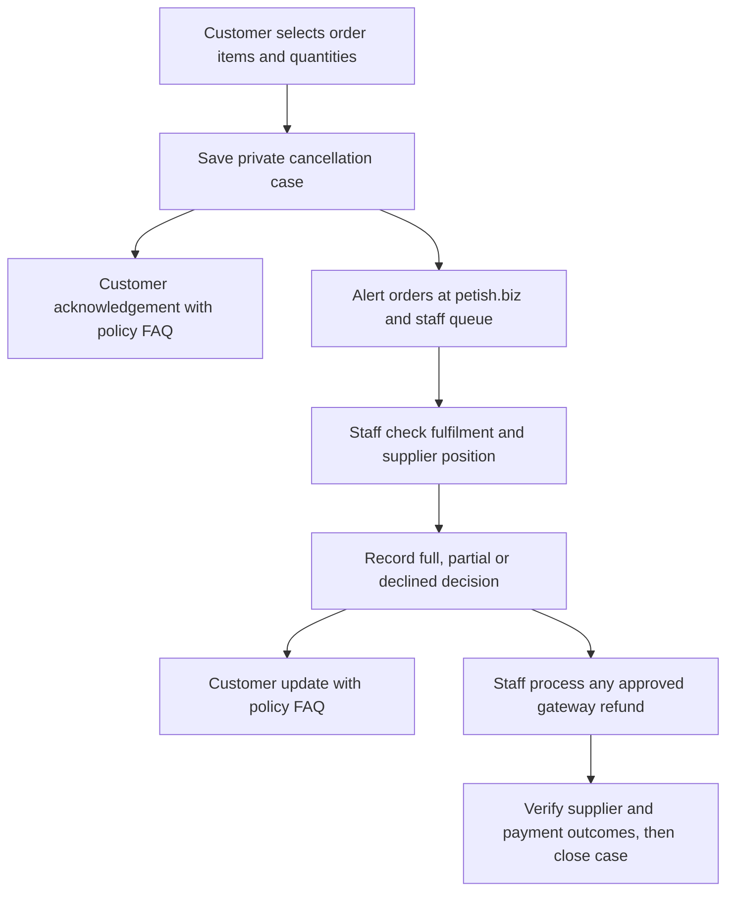

# Customer cancellation requests and account navigation

Verified private staging release: Petish Fulfilment 0.8.0, 24 October 2026
(Australia/Melbourne). This is a request-and-review workflow. It does not cancel
a supplier purchase, change native order status, transfer money or calculate a
processing-fee deduction.

## Customer and staff flow

The signed-in order owner uses **My account → Orders → Request cancellation**.
The order page offers item selection, quantities and an optional reason. All
quantities are checked again against the native order and its recorded refunds.
An active request is reused; resubmitting does not change its selection or send
another acknowledgement. Customers can view the case after the underlying
order becomes cancelled or refunded.

The acknowledgement means **request received**. It does not mean the supplier
has stopped, cancellation is approved or money has been returned. A dispatched
item may need an authorised return. Missing tracking is not proof that an item
is unfulfilled.

Staff use **WooCommerce → Cancellation requests**, with a persistent open-case
count and a warning on the native order. Each case contains selected lines,
progress, a supplier confirmation/reference, per-line accepted quantities,
customer-visible messages, private notes and history. The order link opens the
existing WooCommerce refund controls. Approved cases remain open until staff
explicitly verify supplier and payment outcomes and close them.

The staff checklist includes preventing further supplier placement while the
request is reviewed. This is an operational warning: there is no verified DSers
hold or cancellation API connection. Supplier contact and native gateway
refunds remain staff actions. A manually selected Refunded status or manual
refund record is not proof that funds moved.

## Shared cancellation and return policy

The owner selected these terms for voluntary change-of-mind requests:

- Make every reasonable effort to act promptly and stop unfulfilled items
  where possible; request cancellation from an already-processing supplier.
- Request a change-of-mind return within **14 days after delivery**. Items must
  be **unused, complete and in original packaging**.
- Obtain Petish's authorisation and return address first. The customer pays
  voluntary change-of-mind return postage.
- Staff assess and disclose any applicable, non-recoverable payment-processing
  costs before the refund, and deduct them only where permitted. No universal
  $10 fee or automatic deduction is implemented. Check the actual transaction,
  terms applicable to that purchase and the legal basis for any deduction.
- Process an approved refund after cancellation confirmation, or after the
  authorised return is received and assessed. Use the original payment method.
  Confirm the treatment of delivery charges as part of the assessment.

Faulty, damaged, incorrect-item and other statutory claims are separate. The
change-of-mind window, condition, processing-fee and postage terms cannot limit
rights under Australian Consumer Law or other applicable consumer law. Native
order completion and dispatch dates are not verified delivery dates; staff
assess the 14-day return window against actual delivery evidence.

The canonical policy is in
[`Petish_Cancellation_Policy`](../wordpress/wp-content/plugins/petish-fulfilment/includes/class-petish-cancellation-policy.php).
Its `[petish_faqs]` section belongs on the existing
**Delivery & Shipping** page, linked at `/delivery-shipping/#change-of-mind`.
There is no new FAQ page. The same complete change-of-mind FAQ appears at the
bottom of every customer cancellation acknowledgement and update, after the
case-specific details and before the existing branded footer.

## Email delivery and privacy

Notifications use the existing native mail pipeline and Petish branding,
including the approved animal logo. Staff alerts go to `orders@petish.biz`.
Customer messages use the native order's validated billing recipient after a
fresh ownership check. Private supplier references, internal notes and delivery
diagnostics are excluded from customer messages.

The request and its pending notification events are saved together before
submission. Each audience is claimed under the order lock before invoking mail
outside the lock. Accepted submissions are recorded separately from inbox
delivery. False responses, exceptions and expired claims become uncertain;
there is no automatic ambiguous retry. Staff can inspect previews, send pending
events and resolve uncertainty using provider evidence before retrying.

The private queue remains the work record when email cannot be delivered. This
version has no background reminder worker. New requests attempt their pending
messages after saving; staff can recover pending messages from the queue.

Both `petish_cancellation_requests_enabled` and
`petish_cancellation_emails_enabled` default off. Including or deploying source
does not enable them. Staff can change the two switches on the cancellation
queue page through a dedicated capability/nonce-protected form. Saving the
switches sends no existing pending messages; those have explicit queue
controls. Native refunds, stock, prices, order statuses and supplier
integrations are not changed by this feature.

## Header account menu

The header update increases primary navigation text to 16px and moves the
native My account item to the right. Its main link still opens My account; a
separate avatar/dropdown control exposes the same native account sections as
the left-side navigation, including Passport and My reviews links.

The cached header starts with generic account markup. A private, same-origin
response supplies the current user's account items and avatar. User photos and
logout nonces are not embedded in shared page-cache HTML. The menu supports
keyboard, touch, outside-click and Escape handling, uses the existing light and
dark palette, and preserves the Cart quantity badge.

## Editable homepage photographs and review spacing

**Homepage → Hero images** in WordPress now provides native Media Library
pickers for the four existing animal photographs, a preview, reset-to-default
controls and Save changes. The direct admin route is
`/wp-admin/admin.php?page=petish-hero-images`. The option stores public image
attachment IDs; missing, deleted or private choices fall back to the original
photographs. Uploaded replacements do not inherit the original photographer's
credit, the rabbit's mirroring or the hamster's stock-only backdrop treatment.
Admin access requires `edit_theme_options`; no default option is written just
by loading the theme.

Your reviews now shares the product chooser's main column and follows it with
a 22px gap. The tall reviewer sidebar no longer pushes it below the grid. The
mobile order is composer, reviews, then sidebar. Stylesheet versions use content
hashes for these edited assets so their browser cache URLs follow the actual
file contents.

## Release and verification boundary

Development uses a fresh disconnected WordPress/WooCommerce database for
customer/staff transitions, email captures and both classic/HPOS order storage.
No real payment or supplier action is tested here.

The staging preparation adds only the managed FAQ suffix to the existing
published Delivery & Shipping page, preserving the exact observed staging copy
and saving the prior page privately before committing. That existing copy's
SHA-256 is pinned in the tool; its ownership marker also binds the retained
prefix. Other unknown manual content or
an unexpected existing marker is refused. It creates no FAQ page and enables
no feature or mail flags.

The separate hosted verification checks exact installed application source,
private staging isolation, default-off controls, policy content and access
boundaries. It does not create customer cases, send messages or issue refunds.
Production activation and the real DSers cancellation test remain separate.

## Hosted staging evidence

| Step | Receipt | Result |
|---|---|---|
| Application install, source `f992218` | [40056331426-1](https://github.com/nkrake6/petish/tree/automation-status/staging-40056331426-1) | All eight deployment steps passed |
| Delivery-page FAQ append, tooling `4afaa63` | [40057865883-1](https://github.com/nkrake6/petish/tree/automation-status/cancellation-requests-40057865883-1) | All 55 checks passed |
| Read-only final verification, tooling `4afaa63` | [40057924326-1](https://github.com/nkrake6/petish/tree/automation-status/cancellation-requests-40057924326-1) | All 57 checks passed |
| Read-only native email preview, tooling `6bd6724` | [40057482298-1](https://github.com/nkrake6/petish/tree/email-preview/40057482298-1) | All seven order/account email types rendered with Petish branding |

The later tooling commits do not change the installed application files. Both
cancellation receipts match all **24 Fulfilment files and nine relevant theme
files**. Preparation preserved the existing delivery body byte for byte and
appended the managed FAQ suffix; it created no page. Its full private page
checkpoint was saved before the transaction committed. Final verification made
no SQL writes. Protected orders, users, stock, prices, Passport data, media and
settings were preserved, and temporary remote tools were removed.

Request and cancellation-email switches remain off. The hosted checks do not
create customer cases, choose replacement hero attachments, exercise an
authenticated header in a browser, contact suppliers or send messages. Native
local tests cover the forms, save/reset controls and case transitions; this is
not a claim of complete hosted browser or real supplier/payment coverage.
Production and `main` remain unchanged.

Open the staged [hero editor](https://staging.petish.biz/wp-admin/admin.php?page=petish-hero-images),
[delivery FAQs](https://staging.petish.biz/delivery-shipping/#change-of-mind),
[staff cancellation queue](https://staging.petish.biz/wp-admin/admin.php?page=petish-cancellation-requests)
or [My reviews](https://staging.petish.biz/my-account/?my-reviews=1) after signing
in. See [illustrative component screenshots](cancellation-previews/README.md).

## Local verification

The full cancellation workflow passed **122 native checks in classic order
storage and 122 in HPOS**, using fresh disconnected WordPress 7.1.3 /
WooCommerce 11.2.1 data. This includes owner/stranger access, selected quantities
after prior refunds, duplicate acknowledgement suppression, real Petish email
branding, complete FAQ at the bottom of customer messages, partial staff
decisions, uncertain sending and unchanged order/stock/totals/refund records.

The revised delivery-page preparation passed **39 additional native helper
checks in each order store**: preserve existing content, reject collisions,
rollback after an update if the checkpoint fails, idempotent suffix handling,
safe creation of a missing staging counterpart and a real competing database
writer blocked by the page lock. Native SQL and metadata round-trips also
preserved Unicode, quotes and backslashes byte for byte in the observed-prefix
path, and bound the marker to the actual retained prefix hash. A missing staging
counterpart uses only the reviewed live delivery copy; unknown manual content
is not overwritten.

The hero controls and staff activation switches passed **56 native WordPress
checks**, including real PNG metadata, Settings API registration/save/reset,
public/private attachment boundaries and zero mail calls when switches change.
Hero boundary tests passed 71 assertions and its media-control browser fixture
passed 15 checks. The account dropdown passed 39 PHP assertions and 36 browser
checks. Review layout geometry passed at 1440, 800 and 390px.

Customer forms, statuses, policy FAQs and actual branded email shells were also
checked in local Chromium at desktop/mobile widths and light/dark themes, with
all requests intercepted locally. These are component/fixture checks, not a
claim of full The7 hosted browser coverage. All owned native test containers,
databases, volumes and scratch files were removed.
